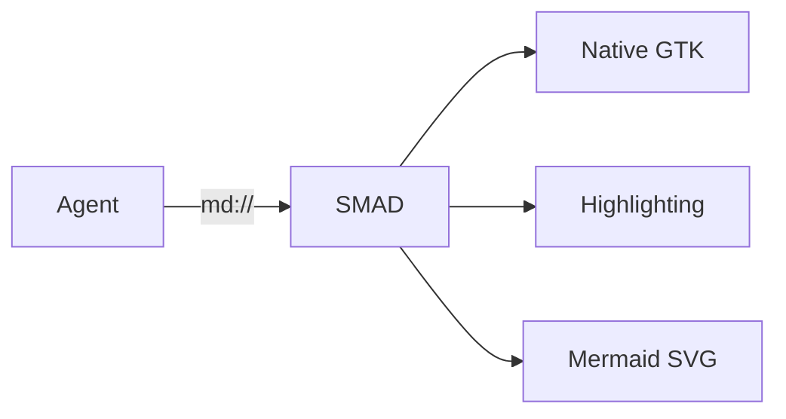
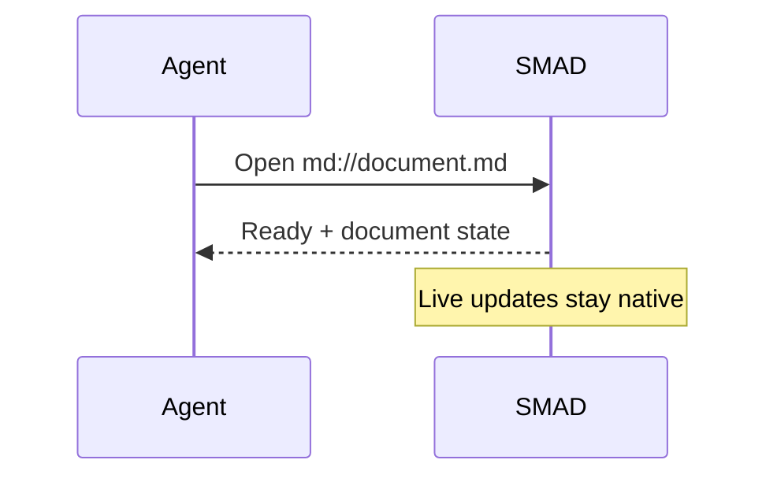

# SMAD · native rendering

**Markdown, code, diagrams and tables — no embedded browser.**

## A real table

| Feature | Detail | Status |
| :--- | :---: | ---: |
| **Code** | `Rust`, Python, JSON and more | Highlighted |
| *Mermaid* | Native SVG | Rendered |
| [Navigation](next.md#next-steps) | 日本語 · 🌲 | Native links |

## Highlighted code

```rust
fn main() {
    let message = "Show Me Agent Document";
    println!("{message}"); // native syntax colours
}
```

## A native diagram



## Another diagram family



## Explicit error behavior

This deliberately invalid diagram must show a diagnostic and retain its source:

```mermaid
not-a-supported-diagram this is intentionally invalid
```

Unknown code languages remain readable plain code:

```unregistered-language
some source that should never disappear
```

Raw HTML remains inert: <b>not an HTML renderer</b>.
