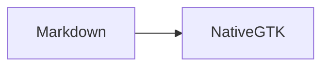

# Native reading, without a browser

A quiet place for **important ideas**, *careful explanations*, and ~~superseded plans~~.
This paragraph wraps naturally. Select text across this paragraph, the list, and the code block.

## A small plan

- Keep existing Lavish review sessions intact.
- Render Markdown in native GTK.
  - Capture the invoking HerdR project.
  - Reuse an existing document in that project.
- [x] Support selectable text
- [ ] Validate the reader with a human

> A reader should stay out of the way. Atomic saves must not lose the document or its scroll position.

1. Read the plan.
2. Follow the [relative document](next.md#next-steps).
3. Return to [this section](#a-small-plan).

## Native table

| Surface | Rendering | Selection |
| --- | --- | --- |
| Markdown | GTK TextView | Cross-block |
| Review | Existing WebKit | Unchanged |
| Mermaid | Literal code for now | Selectable |

## Code and images

```rust
fn main() {
    println!("No HTML conversion, no JavaScript runtime");
}
```


[External documentation](https://docs.gtk.org/gtk4/) opens in the system browser.
[Unsupported local HTML](unsupported.html) must not launch an embedded browser.

## Explicit POC limits

Mermaid diagrams remain code, not generated images:



<script>alert('inert raw HTML')</script>

## A small plan

Duplicate heading anchors receive a suffix: [second plan](#a-small-plan-1).
