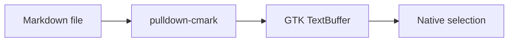

# Native Markdown · the full tour

**This document is rendered by native GTK, not a browser.** It deliberately mixes working features with clearly labeled unsupported features. No part of this page runs JavaScript.

Start here: select text across several paragraphs and a code block. Use the **Links** menu if clicking a text link is awkward. The refresh button reloads this file from disk.

## Jump to a feature

- [Typography and selection](#typography-and-selection)
- [Lists and quotes](#lists-and-quotes)
- [Tables and their limitations](#tables-and-their-limitations)
- [Code and Mermaid](#code-and-mermaid)
- [Images](#images)
- [Links and navigation](#links-and-navigation)
- [Unsupported syntax](#unsupported-syntax)
- [Live updates and recovery](#live-updates-and-recovery)
- [Performance and guardrails](#performance-and-guardrails)

---

## Typography and selection

**WORKS:** paragraphs, **bold**, *italic*, ***bold italic***, ~~strikethrough~~, `inline code`, and escaped punctuation: \*not italic\*.

This is one paragraph with a soft line break
that should remain on the same flowing line. This line uses a hard-break escape:\
This sentence starts after a hard line break.

### Heading level three

#### Heading level four

##### Heading level five

###### Heading level six

Selection is continuous across these blocks. Try dragging from the paragraph above through the list below, or use Ctrl+A then Ctrl+C. This is a **reader**: typing does not edit the source.

**LIMIT:** live updates rebuild the text buffer. Active selection does not survive an update. There is no built-in editor, search interface, or code-copy button.

## Lists and quotes

**WORKS:** ordered and unordered lists, nested items, and task markers.

- First idea
- Second idea
  - A nested supporting detail
  - Another nested detail
    - One level deeper
- Final idea

1. Read the document.
2. Follow a relative link.
3. Return using the companion's explicit link.

- [x] Selectable text
- [x] Local Markdown navigation
- [ ] Human review of the reading experience

**LIMIT:** task checkboxes are display-only. Clicking them does not change the file. Spacing and nesting are a first-pass reader layout, not GitHub's exact presentation.

> A quote is rendered using native text styling.
>
> **Nested formatting** and a [link inside a quote](#tables-and-their-limitations) should remain usable.

## Tables and their limitations

**WORKS:** ordinary GFM table content is readable and selectable across rows. It is monospaced text, not a grid of GTK cells.

| Feature | Rendering | Result |
| --- | --- | --- |
| Prose | Native text tags | Selectable |
| Local image | Native paintable | Visible |
| Review session | Existing WebKit path | Unchanged |
| Mermaid | Code fence | Not a diagram |

**LIMIT — alignment markers:** all three columns below use the same text layout even though the source asks for left, center, and right alignment.

| Left | Center | Right |
| :--- | :---: | ---: |
| alpha | beta | 12.50 |
| longer text | small | 1000 |

**LIMIT — inline formatting and links in tables:** content is flattened. The bold word below is plain text and the table link is not an interactive native link.

| Source feature | Example |
| --- | --- |
| Bold | **Not bold in the table** |
| Link | [Not clickable here](next.md) |
| Inline code | `plain table text` |

**LIMIT — Unicode column widths:** these cells deliberately contain wide characters and combining marks. Their separators can misalign because the POC counts characters, not rendered display width.

| Language | Sample | Note |
| --- | --- | --- |
| English | reader | Narrow |
| Japanese | 日本語 | Wide glyphs |
| Emoji | 🌲 🌊 | Font-dependent width |
| Combining | é | Combining accent |

## Code and Mermaid

**WORKS:** fenced and indented code remain selectable, preserve whitespace, and use a monospace font.

```rust
fn main() {
    let message = "Native GTK, no HTML conversion";
    println!("{message}");
}
```

    An indented code block
        keeps its indentation.

**NOT IMPLEMENTED:** syntax highlighting. The language label on the Rust fence does not color keywords.

**NOT IMPLEMENTED:** Mermaid diagrams. The following must stay literal code—not silently switch to WebKit, not generate an SVG, and not execute a JavaScript runtime.



## Images

**WORKS:** this local SVG is loaded through the native image pipeline and scaled within 720 × 480. Its alt text remains visible.


**EXPECTED PLACEHOLDER:** the next image deliberately does not exist. The rest of the document should still render.


**NOT IMPLEMENTED:** fetching remote images. This reserved example URL must not cause a network fetch; it produces an unavailable-image placeholder.


**LIMIT:** image asset changes alone are not watched. Use Reload after editing the SVG. Images are not selectable as text, but their alt text is.

## Links and navigation

**WORKS:** local document links resolve relative to this document, not to the shell's current directory. Both text links and the keyboard-accessible Links menu use the native reader.

- [Companion document and heading](showcase-companion.md#destination)
- [Same-document heading](#typography-and-selection)
- [Percent-encoded filename with spaces](a%20spaced%20document.md#space-friendly)
- [Second repeated heading](#repeated-heading-1)
- [Unknown heading: expect a status message](#there-is-no-such-heading)
- [Missing Markdown file: expect an error, not a new browser page](missing-document.md)

**EXPECTED REJECTION:** local HTML is not Markdown. This link should show an error in the toolbar, not open an embedded browser.

[Local HTML intentionally refused](unsupported.html)

**EXPECTED REJECTION:** unsupported schemes do not launch an application.

[FTP link intentionally refused](ftp://example.invalid/document.md)

**EXTERNAL HANDLER:** these links are real actions. Only click them if you want to open the system browser or compose an email; the reader does not send an email itself.

- [GTK documentation in your system browser](https://docs.gtk.org/gtk4/)
- [Compose an email to a reserved example address](mailto:nobody@example.invalid)

**LIMIT:** there are no Back/Forward history controls. Use the document list or the explicit return links. Opening the same canonical Markdown file again in the same project reuses it; another project can hold a separate view.

### Repeated heading

This is the first heading. Its anchor is `repeated-heading`.

### Repeated heading

This is the second heading. Its anchor is `repeated-heading-1`.

## Unsupported syntax

**RAW HTML IS INERT:** the following is displayed as text. It must not produce an HTML disclosure widget, styled HTML, or a script side effect.

<details><summary>This must not be an interactive HTML disclosure</summary>Plain inert HTML text.</details>

<script>console.log("This script must never run");</script>

**MATH IS NOT RENDERED:** dollar signs and formulas stay literal.

Inline math: $E = mc^2$.

$$
\int_0^1 x^2\,dx = \frac{1}{3}
$$

**FOOTNOTES ARE NOT IMPLEMENTED:** this is a raw reference[^demo], not a linked footnote system.

[^demo]: This definition may remain ordinary Markdown text, not a semantic footnote.

**BARE-URL AUTOLINK EXTENSION IS NOT ENABLED:** the bare URL below is plain text. Explicit Markdown links, demonstrated above, work.

https://example.invalid/this-is-not-an-automatic-link

**NOT CLAIMED:** complete GFM conformance, exact GitHub heading-slug behavior, a syntax-highlighted editor, native Mermaid, or a full screen-reader/accessibility certification.

## Live updates and recovery

**WORKS:** edits to this file are picked up after roughly 180 ms of quiet time. The watcher follows the parent directory, so atomic replacement saves are handled as well.

Live-edit marker: **READY — edit this sentence on disk to watch it change.**

**WORKS, WITH LIMITS:** the reader attempts to retain the vertical pixel offset during updates. It does not track a semantic paragraph anchor, so inserting material above your viewport can move the text you were reading.

**RECOVERY:** if a previously loaded file is deleted, replaced with invalid UTF-8, or exceeds a rendering guardrail, its last-good buffer remains visible with an error in the toolbar. Restoring valid content recovers automatically. The automated test exercises deletion, atomic replacement, recovery, and scroll retention.

These are lifecycle behaviors, not syntax you can embed in a static page. The demo does not automatically delete your file or perform destructive tests. The source file is `tests/fixtures/markdown/showcase.md`; edit it in your usual editor if you want to try live reload.

## Performance and guardrails

**WORKS:** Markdown-only views do not create a WebKit web subprocess. The application still links GTK and WebKit for existing review sessions, so this is not a zero-overhead text viewer.

In the isolated software-rendered test, the complete native-only application used about **160 MiB RSS**. This is a measurement, not a memory guarantee. Thirty reloads and watcher cleanup are exercised by the test; a long-duration leak benchmark is still pending.

The reader deliberately refuses content beyond these POC guardrails:

| Guardrail | Limit |
| --- | --- |
| Markdown input | 1 MiB, valid UTF-8 |
| Parser events | 20,000 |
| List nesting | 16 levels |
| Interactive links | 256 |
| Table rows | 1,000 |
| Table columns | 12 |
| Table cell text | 256 characters |
| Local images per document | 32 |
| Individual image file | 8 MiB |
| Source image dimensions | 8192 by 8192 |

Over-limit fixtures are deliberately not embedded here: doing so would reject this entire render rather than demonstrate the working features. These are resource guardrails, not a hostile-file sandbox.

## End of the tour

[Return to the beginning](#native-markdown--the-full-tour)

Things worth your feedback: typography, paragraph width, list spacing, table readability, link behavior, image sizing, selection, and whether the native surface feels lighter than a review page.
