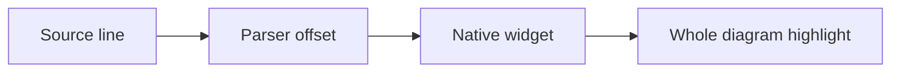

# Markdown source mapping laboratory

## Paragraphs, wrapping, and inline formatting

FIRST source line: this is ordinary paragraph text with **bold words** and *emphasis*.
SECOND source line: highlight only this text, including é, 🦀, &amp;, and an escaped \*star\*.
THIRD source line: same rendered paragraph, but this text must stay unhighlighted.

A paragraph with a deliberately long source line that will wrap over several visual rows when the window is narrow: selecting this one source line should highlight all of its rendered text, without treating the visual wraps as new source coordinates.

A hard break follows this line.\
This text belongs to the next source line.

Inline `single-line code`, ~~strikethrough~~, [a link](next.md), and <https://example.com>.
Multiline inline code begins: `first inline
second inline
third inline` and returns to normal text.

A **strong span starts here,
STRONG TARGET continues on this source line,
and ends here** without colouring the neighbouring source lines.

## Headings

### Heading with **strong** and `code`
#### Level four
##### Level five
###### Level six

Setext heading text
-------------------

## Lists, tasks, and quotations

- First bullet
  continued on this source line with **strong text**.
  - Nested bullet
    nested continuation on a separate line.
- Second bullet

1. First ordered item
2. Second ordered item
   continuation with `inline code`.

- [x] Completed task
- [ ] Pending task

> First quoted source line.
> Second quoted source line with *emphasis*.
>
> - A list inside a quotation
>   with a continuation.

## Exact code lines

```rust
fn main() {
    let message = "HIGHLIGHT ONLY THIS CODE LINE 🦀";
    println!("{message}");

}
```

    first indented code line
    second indented code line
    third indented code line

- Code nested inside a list:

  ```python
  first = 1
  second = 2
  third = first + second
  ```

```unknown-language
Unknown grammar stays plain text.
UNKNOWN TARGET stays precisely mapped.
```

## Tables

| Name | Detail | Count |
| :--- | :---: | ---: |
| Alpha | **Bold**, `code`, and [link](next.md) | 1 |
| Bravo | SELECT THIS ROW ONLY | 2 |
| Charlie | Escaped pipe: a\|b; entity: &amp; | 3 |

## Whole diagram mapping



## Images and references


A [reference link][target] has visible text here, but its destination definition is elsewhere.
A reference image follows: ![Referenced landscape][picture].

[target]: next.md "Reference title"
[picture]: landscape.svg

## Inert HTML and unsupported extensions

Inline <strong>HTML is inert</strong>, not executed.

<div>
Raw HTML block line one.
Raw HTML block line two.
</div>

Footnote-like syntax is not enabled: note[^one].

[^one]: This is not a rendered footnote in the current dialect.

Term
: Definition-list syntax is not enabled either.

Math is literal: $x^2$ and $$y = mx + b$$.

---

Final paragraph. Blank lines, reference definitions, fence markers, table delimiters,
and setext underline markers may have no visible text counterpart. The POC must report
those honestly rather than highlight an unrelated neighbouring line.
